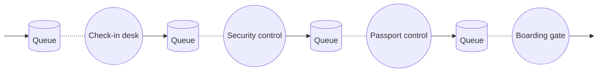
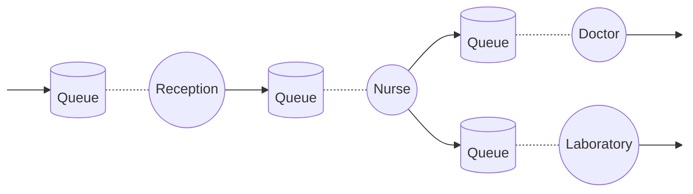

# Task 3 (W): Two systems of service points

## System 1: Airport departure (four service points in series)

Passengers go through four service points one after the other: check-in, security control, passport control and the boarding gate.

## System 2: Health centre (four service points, with branching)

A patient registers at the reception and sees a nurse. After that, the nurse sends the patient either to the doctor or to the laboratory (for example for a blood test).

## Explanation

- System 1 is a pure **serial** system: every customer visits all service points in the same order, so the slowest service point (the bottleneck) limits the whole system.
- System 2 has a **branch**: after the nurse, customers go to different service points, so each of the later service points sees only part of the customers.